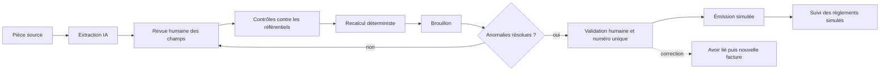
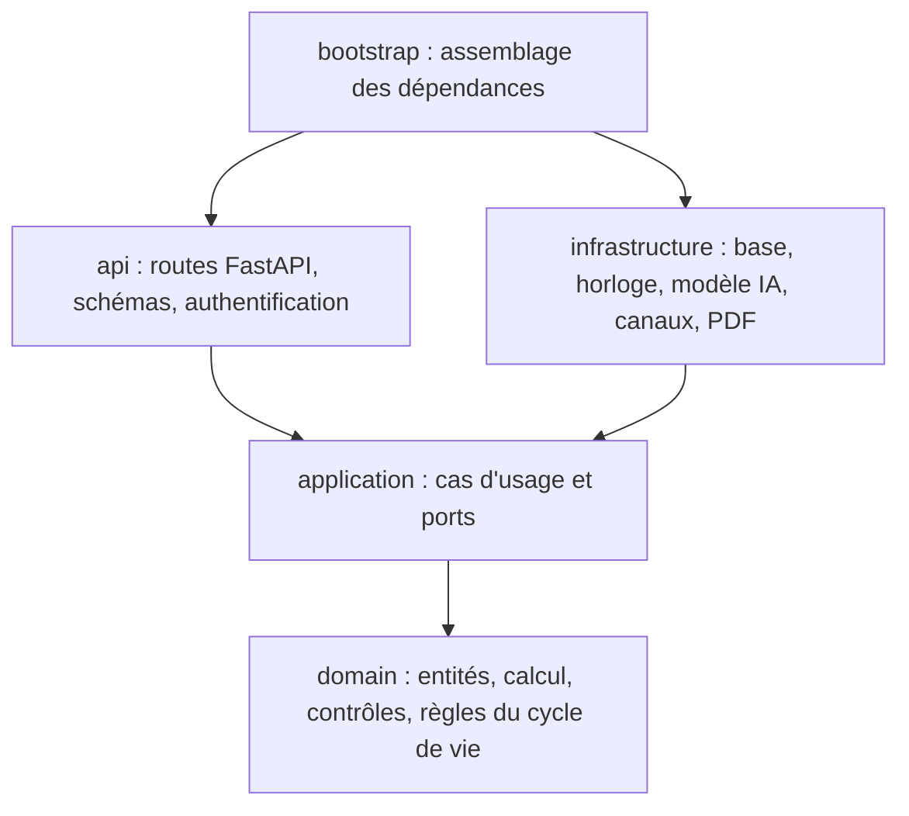

# Vue d'ensemble de l'architecture

> Statut : partiel · Mis à jour : 2026-11-25 · Responsable : Ange-Marie

Décision de référence : [ADR 0001](../adr/0001-architecture-generale.md). Ce document décrit
l'architecture telle qu'elle est ; il évolue avec le code.

## Parcours métier



Chaque flèche qui change un état écrit une entrée dans le journal d'audit.

## Couches et sens des dépendances



| Couche | Contenu | Peut importer | Responsables |
| --- | --- | --- | --- |
| `domain` | Entités immuables, montants, moteur de calcul, contrôles, règles de transition des statuts | Bibliothèque standard uniquement | Grâce (calcul, contrôles), Promis (cycle de vie) |
| `application` | Cas d'usage (importer, corriger, valider, émettre, enregistrer un règlement, émettre un avoir) et **ports** (interfaces) | `domain` | Promis |
| `extraction` | Pipeline d'extraction, normalisation, score de confiance, derrière le port `Extractor` | `domain` | Charbel (socle : Ange-Marie) |
| `infrastructure` | Adaptateurs des ports : dépôts SQLAlchemy, horloge, modèle IA, canaux simulés, rendu PDF | `application`, `domain` | Promis, Grâce, Charbel |
| `api` | Routes, schémas Pydantic, authentification, traduction des erreurs | `application`, `domain` | Promis |
| `bootstrap` | Seul endroit qui relie les ports aux adaptateurs selon la configuration | Toutes | Ange-Marie |

## Ports

| Port | Rôle | Adaptateurs prévus |
| --- | --- | --- |
| `Extractor` | Lire une pièce et rendre des champs extraits | Extracteur local par règles (actif par défaut, hors ligne) ; modèle en ligne si configuré avec une clé ; rejeu de réponses enregistrées (tests) |
| `Clock` | Donner la date et l'heure | Horloge système ; horloge figée sur la date de référence |
| `Store` et `Transaction` | Lire et écrire toutes les entités dans une transaction, compteurs de numéros et journal d'audit compris | SQLite (bibliothèque standard), verrou d'écriture pris à l'ouverture (`BEGIN IMMEDIATE`) ; journal protégé par des déclencheurs contre la modification et la suppression |
| `IdempotencyStore` | Mémoriser les réponses déjà rendues | Table SQLite |
| `UserDirectory` | Authentifier et résoudre les jetons | Comptes de `config/utilisateurs.yaml` (scrypt), jetons en mémoire |
| `Channel` | Émettre une facture | WhatsApp, SMS, courriel simulés ([ADR 0005](../adr/0005-simulation-des-integrations.md)) |
| `DocumentRenderer` | Produire le PDF | Gabarit HTML rendu en PDF |

## Structure du dépôt

```text
.
├── backend/
│   ├── pyproject.toml          dépendances et configuration des outils
│   ├── uv.lock                 versions verrouillées
│   ├── src/invoicing/
│   │   ├── domain/
│   │   ├── application/
│   │   ├── extraction/
│   │   ├── infrastructure/
│   │   ├── api/
│   │   └── bootstrap.py
│   └── tests/
│       ├── unit/
│       ├── integration/
│       └── fixtures/
├── frontend/                   React, Vite, TypeScript (ADR 0004)
├── config/                     règles métier en YAML : taxes, arrondis, seuils, numérotation, canaux
├── data/
│   ├── referentiels/           clients et articles en CSV
│   ├── pieces/
│   │   ├── mise-au-point/      pièces et valeurs attendues pour régler l'extraction
│   │   └── test/               pièces et valeurs attendues réservées à l'évaluation finale
│   └── scenarios/              scénarios de démonstration et de reprise
├── docs/
└── compose.yaml                installation de référence en une commande
```

## Garanties de fiabilité et où elles vivent

| Garantie | Mécanisme | Couche |
| --- | --- | --- |
| Calculs exacts et reproductibles | `Decimal`, arrondis configurés, horloge injectée | `domain` |
| Aucune donnée inventée | Statut « absent » porté jusqu'à l'interface ; validation bloquée tant qu'un champ obligatoire est absent | `extraction`, `domain` |
| Numéro unique sans trou | Attribution dans la transaction de validation ; annulation de la transaction en cas d'échec | `application`, `infrastructure` |
| Validations concurrentes | Numéro de version sur la facture ; la seconde validation reçoit un conflit | `application`, `api` |
| Idempotence | Clé d'idempotence envoyée par le client et mémorisée avec la réponse | `api`, `infrastructure` |
| Facture validée immuable | Aucune transition de modification depuis VALIDÉE ; correction par avoir | `domain` |
| Traçabilité | Journal d'audit en ajout seul, chaque entrée chaînée à la précédente par empreinte | `infrastructure` |
| Reproductibilité des règles | Empreinte de la configuration enregistrée avec chaque facture | `application` |
