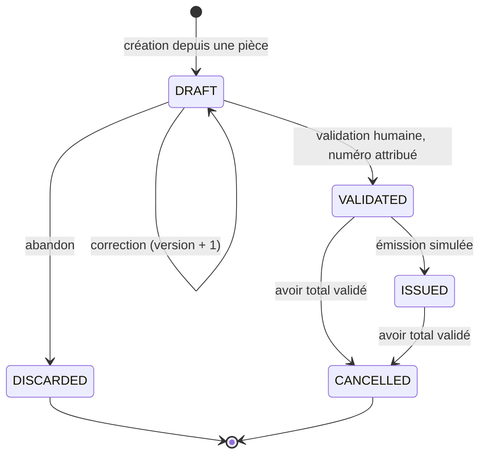

# Cycle de vie de la facture et de l'avoir

> Statut : en vigueur · Mis à jour : 2026-11-24 · Responsable : Promis

Décisions structurantes : [ADR 0003](../adr/0003-contrats-partages.md).

## Statut de cycle de vie



| Transition | Qui | Conditions | Effets |
| --- | --- | --- | --- |
| Création | OPERATOR | Pièce importée | Statut DRAFT, version 1, anomalies calculées |
| Correction | OPERATOR | Statut DRAFT, version envoyée = version courante | Recalcul, anomalies recalculées, version + 1 |
| Abandon | OPERATOR | Statut DRAFT | Statut DISCARDED, aucun numéro consommé |
| Validation | VALIDATOR | Statut DRAFT ; aucune anomalie BLOCKING ouverte ; version envoyée = version courante ; si `separation_des_taches` est actif, le validateur n'est pas l'auteur du brouillon | Numéro attribué, empreinte de la configuration enregistrée, statut VALIDATED |
| Émission | OPERATOR ou VALIDATOR | Statut VALIDATED ou ISSUED, canal pas encore utilisé avec succès | `Dispatch` créé, statut ISSUED |
| Annulation | Automatique | Avoir(s) validé(s) couvrant la totalité du montant TTC | Statut CANCELLED |

Toute autre transition est refusée. Depuis VALIDATED, **aucun champ de la facture ne change** :
la seule correction possible est un avoir.

## Statut de paiement, dérivé

Le statut de paiement n'est **pas stocké**. Il est calculé à chaque lecture :

```text
solde = montant TTC - total des avoirs validés - total des règlements
```

| Solde | Statut de paiement |
| --- | --- |
| solde = montant TTC net des avoirs, aucun règlement | `UNPAID` |
| 0 < solde < montant TTC net des avoirs | `PARTIALLY_PAID` |
| solde = 0 | `PAID` |

Un règlement est accepté seulement sur une facture VALIDATED ou ISSUED, et si son montant est
inférieur ou égal au solde. Sa référence mobile money est fictive et affichée comme telle.

## Numérotation

- Format défini dans `config/numerotation.yaml`, par défaut `FA-{annee}-{sequence:05d}` pour les
  factures et `AV-{annee}-{sequence:05d}` pour les avoirs.
- Le numéro est attribué **dans la transaction de validation**. Si la transaction échoue, le
  compteur n'avance pas : aucune séquence n'a de trou ni de doublon.
- Un brouillon n'a pas de numéro. Un brouillon abandonné ne consomme rien.

## Avoir

- Créé par un VALIDATOR à partir d'une facture VALIDATED ou ISSUED, avec un motif obligatoire.
- Même cycle que la facture : DRAFT, puis VALIDATED (numéro `AV-...`), puis ISSUED.
- Lignes reprises de la facture, avec des quantités ou montants inférieurs ou égaux à ce qui
  reste à créditer.
- Une correction complète se fait en deux temps : avoir total, puis nouvelle facture en DRAFT
  reliée à la même pièce source.

## Concurrence et idempotence

| Mécanisme | Règle |
| --- | --- |
| Version | Chaque facture et chaque avoir portent un entier `version`. Toute modification envoie la version lue (en-tête `If-Match`). Version différente : refus `409 VERSION_CONFLICT` |
| Clé d'idempotence | Toute requête `POST` porte un en-tête `Idempotency-Key` (UUID généré par le client). Même clé et même contenu : la réponse d'origine est renvoyée, sans nouvel effet. Même clé et contenu différent : refus `409 IDEMPOTENCY_KEY_REUSED` |
| Reprise après coupure | Le client renvoie la même requête avec la même clé. Le résultat est identique à un envoi unique |

Chaque transition écrit une entrée d'audit dans la même transaction que le changement d'état.
