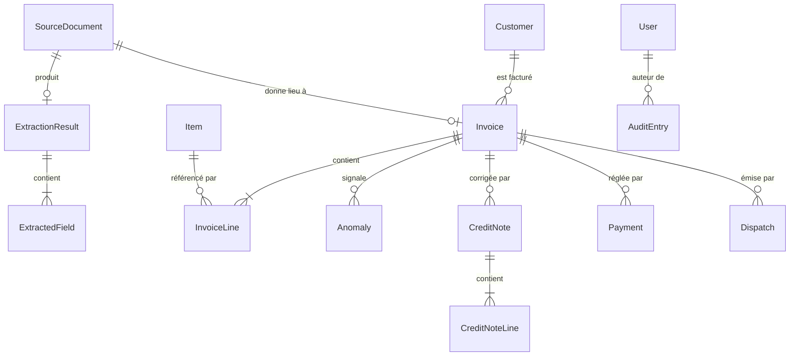

# Modèle de domaine

> Statut : en vigueur · Mis à jour : 2026-11-24 · Responsable : Ange-Marie

Entités du cœur métier et leurs relations. Noms selon le [glossaire](../domaine/glossaire.md).
Décisions structurantes : [ADR 0003](../adr/0003-contrats-partages.md).

## Entités

| Entité | Champs principaux | Règles |
| --- | --- | --- |
| `Customer` | `id`, `legal_name`, `tax_id` (IFU), `phone`, `email`, `preferred_channel`, `payment_terms_days`, `vat_liable` | Chargé depuis `clients.csv`, lecture seule |
| `Item` | `id`, `label`, `unit`, `unit_price_net`, `vat_rate` | Chargé depuis `articles.csv`, lecture seule |
| `SourceDocument` | `id`, `kind` (`pdf`, `image`, `text`), `file_sha256`, `received_at`, `uploaded_by` | L'empreinte `file_sha256` détecte l'import d'un même fichier deux fois |
| `ExtractionResult` | `id`, `source_document_id`, `extractor` (nom et version), `fields`, `created_at` | Immuable. Une nouvelle extraction crée un nouveau résultat |
| `ExtractedField` | Voir [champ-extrait.md](champ-extrait.md) | Une valeur absente reste absente |
| `Invoice` | `id`, `status`, `number` (vide en brouillon), `customer_id`, `source_document_id`, `issue_date`, `due_date`, `lines`, `totals`, `config_sha256`, `version` | Voir [cycle-de-vie.md](cycle-de-vie.md) |
| `InvoiceLine` | `item_id`, `label`, `quantity`, `unit`, `unit_price_net`, `discount_rate`, `vat_rate`, `line_net`, `line_vat` | Montants calculés par le moteur, jamais saisis |
| `Totals` | `net_total`, `vat_total` (par taux), `gross_total`, `credited_total`, `paid_total`, `balance` | `credited_total`, `paid_total` et `balance` sont **dérivés**, jamais stockés |
| `Anomaly` | `id`, `code`, `severity` (`BLOCKING`, `WARNING`), `field`, `message`, `resolution` | Une anomalie `BLOCKING` non résolue empêche la validation |
| `CreditNote` | `id`, `status`, `number`, `invoice_id`, `reason`, `lines`, `totals`, `version` | Total ≤ montant encore non crédité de la facture |
| `Payment` | `id`, `invoice_id`, `amount`, `method`, `reference`, `is_simulated`, `received_at` | `is_simulated` vaut toujours `true` ; montant ≤ solde |
| `Dispatch` | `id`, `invoice_id`, `channel`, `recipient`, `status`, `sent_at` | Une seule émission réussie par facture et par canal |
| `AuditEntry` | `seq`, `at`, `user_id`, `action`, `entity`, `entity_id`, `before`, `after`, `prev_hash`, `hash` | Ajout seul ; `hash` couvre l'entrée et `prev_hash` |
| `User` | `id`, `username`, `role` (`OPERATOR`, `VALIDATOR`, `ADMIN`) | Comptes de test décrits dans le README |

## Codes d'anomalie

| Code | Gravité par défaut | Déclencheur |
| --- | --- | --- |
| `UNKNOWN_CUSTOMER` | BLOCKING | Client absent du référentiel |
| `UNKNOWN_ITEM` | BLOCKING | Article absent du référentiel |
| `DUPLICATE_DOCUMENT` | BLOCKING | Même fichier, ou même client, même référence et même montant qu'une pièce déjà traitée |
| `UNUSUAL_PRICE` | WARNING | Écart au prix de référence au-delà du seuil de `config/controles.yaml` |
| `AMOUNT_MISMATCH` | BLOCKING | Montant lu sur la pièce différent du montant recalculé |
| `QUANTITY_MISMATCH` | BLOCKING | Quantité livrée différente de la quantité commandée |
| `DOCUMENT_INCONSISTENCY` | BLOCKING | Pièces du même dossier contradictoires (client, dates, références) |
| `MISSING_REQUIRED_FIELD` | BLOCKING | Champ obligatoire absent et non saisi par un humain |
| `LOW_CONFIDENCE` | BLOCKING | Champ sous le seuil de confiance, non confirmé par un humain |
| `HIGH_AMOUNT` | BLOCKING | Montant TTC au-delà du seuil de revue de `config/controles.yaml` |

Les gravités sont lues dans `config/controles.yaml` : les valeurs ci-dessus sont les valeurs par
défaut. Résoudre une anomalie exige un utilisateur, une justification écrite et une entrée d'audit.
