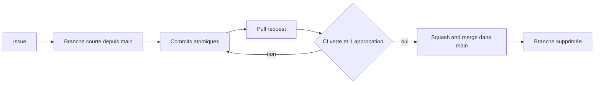

# Conventions Git et GitHub

> Statut : en vigueur · Mis à jour : 2026-11-24 · Responsable : Ange-Marie

## Vue d'ensemble



## 1. Branche `main`

- `main` est toujours dans un état qui s'installe, se lance et passe les tests.
- Personne ne pousse directement sur `main`. Tout passe par une pull request (PR).
- Protection à activer par le propriétaire du dépôt (Charbel) dans *Settings > Branches* :
  PR obligatoire, une approbation, CI verte obligatoire, historique linéaire, poussée forcée
  interdite, suppression interdite.

## 2. Issues

Chaque tâche est une issue, avec un titre explicite et l'étiquette de sa portée
(voir [périmètres](../equipe/perimetres.md)). Une PR ferme son issue avec `Closes #12` dans sa
description. Cela relie chaque ligne de code à la raison qui l'a fait écrire.

## 3. Branches

Format : `<type>/<portée>-<sujet-court>`, en minuscules, mots séparés par des tirets.

| Exemple | Signification |
| --- | --- |
| `feat/metier-calcul-remises` | Nouvelle fonctionnalité du moteur métier |
| `fix/cycle-de-vie-double-validation` | Correction dans le cycle de vie |
| `docs/conventions-git` | Documentation |

- Une branche part toujours de `main` à jour, jamais d'une autre branche : **pas de PR empilées**.
- Une branche vit moins d'une journée. Une tâche plus longue est découpée en plusieurs issues.
- Pour récupérer les nouveautés de `main` : `git merge origin/main` dans sa branche. Pas de
  réécriture d'historique, donc jamais de poussée forcée.

## 4. Commits

Format [Conventional Commits 1.0.0](https://www.conventionalcommits.org/fr/v1.0.0/) :

```text
<type>(<portée>): <description>

<corps : le pourquoi, si la description ne suffit pas>

Refs #12
```

| Type | Usage |
| --- | --- |
| `feat` | Nouvelle fonctionnalité visible |
| `fix` | Correction d'un défaut |
| `refactor` | Changement de structure sans changement de comportement |
| `perf` | Amélioration de performance |
| `test` | Ajout ou correction de tests seuls |
| `docs` | Documentation seule |
| `build` | Dépendances, empaquetage, conteneurs |
| `ci` | Intégration continue |
| `chore` | Maintenance sans effet sur le produit |
| `revert` | Annulation d'un commit précédent |

Règles :

- La portée est l'une de celles du tableau des [périmètres](../equipe/perimetres.md).
- La description est en français, à l'impératif, en minuscules, sans point final,
  72 caractères au plus : `feat(metier): appliquer les remises par ligne avant taxes`.
- Un commit = un changement logique. Les tests passent à chaque commit.
- Un changement incompatible porte un `!` : `feat(api)!: renommer le champ total_ttc`.
- Jamais de secret, de donnée personnelle réelle ou de fichier généré dans un commit.
- Relire `git status` et `git diff --staged` avant chaque commit.

## 5. Pull requests

- Une PR = une issue = un sujet. Viser moins de 400 lignes modifiées hors données et fichiers
  générés.
- Le titre de la PR suit le format des commits : il devient le message du commit dans `main`.
- La description suit le [modèle de PR](../../.github/pull_request_template.md) : quoi,
  pourquoi, comment vérifier, liste de contrôle.
- Une PR n'est fusionnable que si : la CI est verte, un autre membre l'a approuvée, la
  documentation concernée est à jour **dans la même PR**, et aucune discussion n'est ouverte.
- L'auteur fusionne lui-même après approbation, en **Squash and merge**, puis supprime la branche.

Pourquoi *Squash and merge* : chaque entrée de `main` correspond exactement à une PR relue, ce
qui rend l'historique lisible et chaque fonctionnalité annulable par un seul `git revert`. Le
détail des commits reste consultable dans la PR.

## 6. Revue de code

- Relire dans les 2 heures qui suivent la demande, pendant le hackathon.
- Un commentaire dit ce qui ne va pas et pourquoi, et propose une solution si possible.
- Préfixes : `bloquant :` doit être corrigé avant fusion ; `suggestion :` laissé au choix de
  l'auteur ; `question :` demande d'explication.

## 7. Versions

- Numérotation [SemVer](https://semver.org/lang/fr/) par étiquette Git annotée : `v0.1.0`,
  `v0.2.0` pendant le développement.
- La version remise au jury est l'étiquette **`v1.0.0`**, posée sur `main` au gel des
  développements. Son empreinte de commit est citée dans le rapport.

## 8. Secrets

- Aucun secret dans le dépôt. Les variables sont décrites dans `.env.example`, les valeurs
  réelles restent dans `.env`, ignoré par Git.
- Un secret poussé par erreur est considéré comme compromis : on le révoque immédiatement, puis
  on prévient l'équipe.
