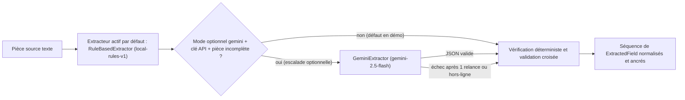

# Fiche IA : extraction locale par règles, calibration de confiance et évaluation

> Statut : en vigueur · Mis à jour : 2026-11-26 · Responsable : Charbel

> [!IMPORTANT]
> **Configuration active en démonstration ([ADR 0005](../adr/0005-simulation-des-integrations.md))** :
> - L'extracteur actif par défaut est l'**extracteur local déterministe par règles** (`local-rules-v1`, configuré par `extracteur_actif: local` dans `config/extraction.yaml`).
> - **La démonstration complète tourne sans clé API et sans connexion Internet.**
> - Le modèle en ligne **Gemini (`gemini-2.5-flash`) est strictement optionnel** : il n'est instancié par `bootstrap.py` que si `extracteur_actif: gemini` est choisi dans `config/extraction.yaml` **et** que la variable d'environnement `INVOICING_GEMINI_API_KEY` est renseignée.
> - Conformément à l'ADR 0005, les intégrations externes (canaux WhatsApp/SMS/courriel, règlements mobile money) sont **simulées** et affichées comme telles ; l'extraction, le moteur de calcul, les contrôles et le journal d'audit sont **réels**.

## 1. Rôle et frontière de l'extraction

Conformément aux [principes d'ingénierie](../conventions/principes.md) et au contrat [champ-extrait.md](../contrats/champ-extrait.md), le pipeline d'extraction transforme une pièce source (`SourceDocument`) en une séquence de champs extraits (`ExtractedField`).

- **Aucun calcul** : l'extracteur ne multiplie jamais une quantité par un prix unitaire et ne cumule jamais plusieurs remises. Tout calcul relève exclusivement du moteur déterministe (`invoicing/domain/calculation.py`).
- **Aucune donnée inventée** : un champ introuvable dans la pièce porte le statut `MISSING` avec `value=null`, `confidence=null` et `anchor=null` (invariant vérifié par `ExtractedField.__post_init__`).
- **Humain dans la boucle** : tout champ `MISSING`, `AMBIGUOUS` ou dont le score `confidence` est inférieur au seuil de `config/extraction.yaml` (`0.85`) bloque la validation et impose une revue humaine.

## 2. Architecture du pipeline et extracteurs implémentés

Le pipeline sépare la logique pure (`backend/src/invoicing/extraction/`, sans dépendance externe, vérifiée par `import-linter`) des adaptateurs techniques (`backend/src/invoicing/infrastructure/`).



| Extracteur | Identifiant (`name`) | Statut en démo | Implémentation actuelle |
| --- | --- | --- | --- |
| **Extracteur local par règles** | `local-rules-v1` | **Actif par défaut** (`extracteur_actif: local`) | `RuleBasedExtractor` (`invoicing/extraction/rules_extractor.py`). Expressions régulières et correspondance sur `CatalogHint` (`clients.csv`, `articles.csv`). 100 % hors-ligne, 0 FCFA, aucune clé requise, aucune donnée envoyée hors du poste. |
| **Extracteur en ligne Gemini** | `gemini:gemini-2.5-flash` ou `cascade:local-rules-v1` | **Optionnel** (désactivé sans clé) | `GeminiExtractor` (`invoicing/infrastructure/gemini_extractor.py`). En cascade `local_first=True`, n'appelle l'API HTTPS Google AI Studio (`temperature=0.0`, `RESPONSE_JSON_SCHEMA`, en-tête `x-goog-api-key`) que si `is_local_extraction_sufficient` renvoie `False`. 1 relance sur erreur transitoire (aucune sur HTTP 400/401/403), puis repli transparent sur le local (`fallback:local-rules-v1`). |
| **Extracteur de rejeu enregistré** | `recorded:gemini-2.5-flash` | Disponible pour tests | `RecordedExtractor` (`invoicing/infrastructure/recorded_extractor.py`). Rejoue des réponses enregistrées indexées par `SHA-256`, avec repli sûr vers des champs `MISSING` si la pièce est inconnue. |

## 3. Vérification déterministe et calibration de la confiance

Toute sortie brute (locale ou issue de Gemini) passe par `verify_and_build_field` puis `finalize_extracted_fields` (`invoicing/extraction/confidence.py`) avec une `CalibrationPolicy` chargée depuis `config/extraction.yaml` et `config/controles.yaml` (`load_extraction_config`) :

1. **Ancrage calculé en Python (`invoicing/extraction/anchoring.py`)** :
   - Les positions `TextAnchor(start, end)` sont calculées en Python à partir de la position réelle du motif (`hint_start` puis `find_text_anchor`), jamais demandées au modèle de langage.
   - Si `raw_text` est introuvable dans la pièce source, le champ est rétrogradé en `MISSING` pour bloquer toute hallucination.
2. **Normalisation sans flottant (`invoicing/extraction/normalization.py`)** :
   - Montants FCFA, quantités et taux normalisés avec `decimal.Decimal` (validés par tests de propriétés Hypothesis).
   - Dates converties en `AAAA-MM-JJ` ; IFU validés sur 13 chiffres exacts ; un format illisible bascule en `AMBIGUOUS` (`value=null`, plafond `0.35`).
3. **Règle du veto (`min`) et garantie d'invariant (`CalibrationPolicy`)** :
   - `CalibrationPolicy.__post_init__` refuse au démarrage tout plafond supérieur ou égal à `seuil_confiance_revue` (`0.85`).

```text
confidence = min(confiance_brute, plafond_ancrage, plafond_referentiel, plafond_financier)
```

| Contrôle (plafonds lus dans `config/extraction.yaml`) | Condition | Plafond | Effet (seuil 0.85) |
| --- | --- | --- | --- |
| Format invalide (`format_invalide`) | Échec de normalisation | `0.35` | Statut `AMBIGUOUS`, revue obligatoire |
| Ancrage de valeur (`non_ancre`) | Chiffres/mots de `value` absents de `raw_text` | `0.40` | Revue obligatoire (`LOW_CONFIDENCE`) |
| Ambiguïté (`ambigu`) | Statut `AMBIGUOUS` ou doublons en conflit | `0.50` | Revue obligatoire |
| Référentiel (`referentiel_inconnu` / `referentiel_partiel`) | Client/article hors CSV ou similarité dans `[0.68, 0.88[` | `0.70` / `0.75` | Revue obligatoire |
| Validation croisée financière (`ecart_prix` / `ecart_total`) | Prix unitaire hors seuil `controles.yaml` (> 20 %) ou écart sur `totals.net` (hors pièces remisées) | `0.75` / `0.70` | Confiance haute conservée sur les tarifs conformes, revue forcée sur tout écart financier |
| Confiance modèle absente (`confiance_modele_defaut`) | Champ sans score brut | `0.70` | Revue obligatoire |

## 4. Jeux de données d'évaluation (`data/pieces/`)

Les 22 pièces sources sont **100 % fictives** et alignées sur `data/referentiels/clients.csv` (10 clients) et `data/referentiels/articles.csv` (20 articles). Elles sont réparties en :

- **`data/pieces/mise-au-point/` (10 pièces, `p001` à `p010`)** : réglage des règles et calibrage du seuil.
- **`data/pieces/test/` (6 pièces, `p011` à `p016`)** : évaluation séparée, mais consultée pendant le réglage (voir la limite ci-dessous).
- **`data/pieces/controle/` (6 pièces, `p017` à `p022`)** : jeu de contrôle étanche, écrit le 26/11/2026 après le gel des règles et évalué **une seule fois** ; aucune règle n'a été modifiée ensuite.

Cas couverts : commandes nominales (`p001`, `p011`), IFU absent (`p002`, `p012`), client inconnu en prose WhatsApp (`p003`, `p013`), doublon (`p004`), remises cumulées ambiguës (`p005`, `p015`), prix inhabituel (`p006`, `p014`), écart de total HT (`p007`, `p015`), livraison partielle (`p008`), message ambigu sans quantité ni prix (`p009`, `p016`), article inconnu et date absente (`p010`).

## 5. Protocole et résultats d'évaluation chiffrée

Commande reproductible (sans clé API, avec les vrais référentiels `data/referentiels/`) :

```bash
cd backend && uv run python -m invoicing.infrastructure.dataset_eval --split all
```

En facturation, une fausse certitude (valeur fausse validée à confiance `>= 0.85`) coûte beaucoup plus cher qu'une revue humaine. Le système optimise donc la **Précision au-dessus du seuil** (objectif : 0 fausse certitude), puis la **Couverture d'automatisation (Rappel)**, résumées par le score **F0.5**.

### Résultats mesurés de l'extracteur actif (`local-rules-v1`, seuil `0.85`)

| Métrique | Jeu `mise-au-point` (10 pièces) | Jeu `test` (6 pièces) |
| --- | --- | --- |
| Sorties valides | 10 / 10 (100,0 %) | 6 / 6 (100,0 %) |
| Exactitude par champ (Accuracy) | 89,5 % (77 / 86) | 90,2 % (46 / 51) |
| Champs vides à raison (True Missing) | 100,0 % (7 / 7) | 100,0 % (7 / 7) |
| Précision au-dessus du seuil (0.85) | 100,0 % | 100,0 % |
| Taux de fausses certitudes | 0,0 % (0) | 0,0 % (0, borne haute IC 95 % ~5,9 %) |
| Couverture d'automatisation (Rappel) | 84,9 % | 88,2 % |
| Score F0.5 | 0,966 | 0,974 |

> [!WARNING]
> **Limite méthodologique assumée** : le jeu `test` initial (6 pièces) ayant été consulté pendant la mise au point des expressions régulières, ses chiffres constituent une mesure interne. Le jeu `controle` ci-dessous est la mesure de référence. Le mode en ligne optionnel (`GeminiExtractor`) n'est pas activé pour la démonstration sans clé et n'a pas fait l'objet d'une passe comparative chiffrée dans ce rapport.

### Mesure de référence : jeu `controle` étanche (6 pièces, 70 champs)

| Métrique | Jeu `controle` |
| --- | --- |
| Sorties valides | 6 / 6 |
| Exactitude par champ | **94,3 %** (66 / 70) |
| Champs vides à raison | **100,0 %** (4 / 4) |
| Précision au-dessus du seuil (0.85) | 100,0 % |
| Taux de fausses certitudes | **0,0 %** (0) |
| Couverture d'automatisation (Rappel) | 92,9 % |
| Score F0.5 | 0,985 |

Commande : `cd backend && uv run python -m invoicing.infrastructure.dataset_eval --split controle`.
Limite : 6 pièces écrites par l'équipe, dans des formats proches des jeux précédents ; l'échantillon
est petit et ne mesure pas la robustesse à des formats réellement nouveaux.

## 6. Calibrage du seuil de revue humaine (`seuil_confiance_revue`)

Grille mesurée sur `data/pieces/mise-au-point/` avec `data/referentiels/` chargés :

| Seuil | Précision >= seuil | Fausses certitudes | Couverture auto (Rappel) | Score F0.5 |
| --- | --- | --- | --- | --- |
| 0.60 | 98,7 % | 1,2 % (1) | 89,5 % | 0,967 |
| 0.70 | 98,7 % | 1,2 % (1) | 89,5 % | 0,967 |
| 0.75 | 100,0 % | 0,0 % (0) | 87,2 % | 0,972 |
| 0.80 | 100,0 % | 0,0 % (0) | 84,9 % | 0,966 |
| **0.85** | **100,0 %** | **0,0 % (0)** | **84,9 %** | **0,966** |
| 0.90 | 100,0 % | 0,0 % (0) | 72,1 % | 0,928 |
| 0.95 | 100,0 % | 0,0 % (0) | 18,6 % | 0,533 |

Le seuil **`0.85`** (dans `config/extraction.yaml`) est retenu car il maintient une marge nette au-dessus de tous les plafonds de sécurité (`0.70` et `0.75` pour les écarts tarifaires et correspondances partielles), garantit **0 fausse certitude (100 % de précision au-dessus du seuil)** et conserve **84,9 % à 88,2 % d'automatisation directe**.

## 7. Analyse des erreurs et cas limites

1. **Messages WhatsApp en prose libre (`p003.txt`, `p008.txt`, `p013.txt`)** :
   - Lorsque l'article, la quantité et le prix sont fondus dans une phrase conversationnelle sans puce, `local-rules-v1` extrait l'en-tête (`customer.name`, `customer.tax_id`, `document.date`) et signale les quantités avec unité non couvertes en `AMBIGUOUS` (empêchant toute perte silencieuse d'une ligne). L'opérateur complète dans l'écran de revue, ou le mode optionnel `gemini` prend le relais s'il est activé avec une clé.
2. **Remises cumulées (`p005.txt`, `p015.txt`)** :
   - Dès que plusieurs pourcentages apparaissent dans un contexte de remise, `discount.global_rate` passe en `AMBIGUOUS` (`value=null`, `confidence=0.40`) : aucun taux cumulé n'est calculé par l'extracteur.
3. **Incohérences financières (`p006.txt`, `p007.txt`, `p014.txt`, `p015.txt`)** :
   - Les montants lus sont conservés fidèlement mais leur confiance est plafonnée (`0.75` / `0.70`), tandis que le moteur métier (`invoicing/domain/controls.py`) lève les anomalies `UNUSUAL_PRICE` et `AMOUNT_MISMATCH`.

## 8. Confidentialité, coûts et exploitation hors-ligne

- **Démo 100 % autonome sans clé** : avec `extracteur_actif: local` par défaut, **aucune donnée ne quitte le poste** et aucune clé API externe n'est nécessaire pour installer, tester ou démontrer le produit.
- **Coût** : 0 FCFA en mode actif (`local-rules-v1`). Si une PME choisit d'activer l'option `extracteur_actif: gemini` avec sa propre clé, la cascade `local_first=True` limite l'envoi aux seules pièces non structurées ; les conditions de rétention et tarifs du palier Google AI Studio restent **[À VÉRIFIER]** avant toute mise en production avec des données réelles.
