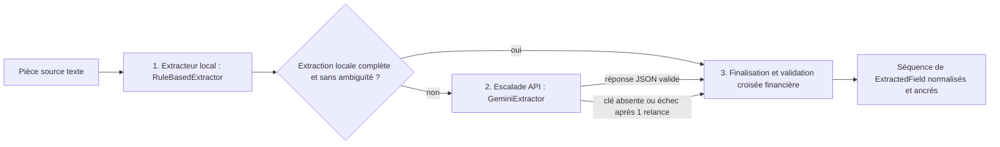

# Fiche IA : extraction, calibration de confiance et évaluation

> Statut : en vigueur · Mis à jour : 2026-11-25 · Responsable : Charbel

## 1. Rôle et frontière de l'extraction

Conformément aux [principes d'ingénierie](../conventions/principes.md) et au contrat [champ-extrait.md](../contrats/champ-extrait.md), le pipeline d'extraction transforme une pièce source (`SourceDocument`) en une séquence de champs extraits (`ExtractedField`).

- **Aucun calcul** : l'extracteur ne multiplie jamais une quantité par un prix unitaire et ne cumule jamais plusieurs remises. Tout calcul est délégué au moteur déterministe (`invoicing/domain/`).
- **Aucune donnée inventée** : un champ introuvable dans la pièce porte le statut `MISSING` avec `value=null`, `confidence=null` et `anchor=null` (invariant garanti par `ExtractedField.__post_init__`).
- **Humain dans la boucle** : tout champ `MISSING`, `AMBIGUOUS` ou dont le score `confidence` est inférieur au seuil de `config/extraction.yaml` (`0.85`) impose une revue humaine avant validation.

## 2. Architecture du pipeline et extracteurs implémentés

Le pipeline sépare la logique pure (`backend/src/invoicing/extraction/`, sans dépendance externe) des adaptateurs techniques (`backend/src/invoicing/infrastructure/`). Il applique un routage en cascade **Local-First** derrière le port `Extractor` :



| Extracteur | Identifiant (`name`) | Implémentation actuelle |
| --- | --- | --- |
| **Extracteur local par règles** | `local-rules-v1` | `RuleBasedExtractor` (`invoicing/extraction/rules_extractor.py`). Extraction déterministe hors-ligne par expressions régulières et recherche dans le référentiel (`CatalogHint`). Exécuté en premier sur chaque pièce texte (moins de 5 ms, 0 FCFA, aucune donnée envoyée sur le réseau). |
| **Extracteur en ligne (escalade)** | `gemini:gemini-2.5-flash` | `GeminiExtractor` (`invoicing/infrastructure/gemini_extractor.py`). Appelé uniquement si `is_local_extraction_sufficient` renvoie `False` (champ obligatoire manquant ou champ `AMBIGUOUS`). Appel HTTPS vers Google AI Studio avec `temperature=0.0`, schéma JSON contraint (`RESPONSE_JSON_SCHEMA`), clé passée dans l'en-tête `x-goog-api-key`, validation Pydantic, 1 relance automatique en cas d'erreur, puis repli sur le résultat local. |
| **Extracteur de rejeu enregistré** | `recorded:gemini-2.5-flash` | `RecordedExtractor` (`invoicing/infrastructure/recorded_extractor.py`). Rejoue des extractions enregistrées sur disque indexées par l'empreinte `SHA-256` du fichier source, avec repli configurable. |

## 3. Vérification déterministe et calibration de la confiance

Aucune sortie brute (locale ou issue de Gemini) n'est acceptée directement. Chaque candidat (`RawFieldCandidate`) passe par `verify_and_build_field` puis `finalize_extracted_fields` (`invoicing/extraction/confidence.py`) :

1. **Ancrage calculé en Python (`invoicing/extraction/anchoring.py`)** :
   - Les positions `TextAnchor(start, end)` ne sont jamais demandées au modèle de langage. Elles sont calculées en Python en recherchant `raw_text` dans le texte source (`find_text_anchor`).
   - Si `raw_text` est introuvable dans la pièce source, un champ `FOUND` est immédiatement rétrogradé en `MISSING` pour bloquer toute hallucination.
2. **Normalisation sans flottant (`invoicing/extraction/normalization.py`)** :
   - Les montants FCFA, quantités et taux sont normalisés avec `decimal.Decimal` (`"5 500 FCFA"` devient `"5500"`, `"5 %"` devient `"0.05"`).
   - Les dates (`JJ/MM/AAAA`, `AAAA-MM-JJ`, dates en français) sont validées au calendrier et converties en `AAAA-MM-JJ`.
   - Les IFU sont validés sur 13 chiffres exacts (`customer.tax_id`).
   - Si la valeur brute d'un champ `FOUND` ne respecte pas le format attendu, le champ bascule en `AMBIGUOUS` avec `value=null` et une confiance plafonnée à `0.35`.
3. **Calcul de confiance par règle du veto (`min`)** :
   Pour qu'un champ franchisse le seuil `0.85` sans revue humaine, tous les contrôles déterministes doivent être validés simultanément :

```text
confidence = min(confiance_brute, plafond_ancrage, plafond_referentiel, plafond_financier)
```

| Contrôle | Condition | Plafond appliqué | Conséquence (seuil 0.85) |
| --- | --- | --- | --- |
| **Ancrage de la valeur** (`is_value_grounded_in_raw_text`) | Les chiffres ou mots de `value` n'apparaissent pas dans `raw_text` (calcul implicite ou invention) | `0.40` | Revue humaine obligatoire (`LOW_CONFIDENCE`) |
| **Format invalide** | Échec de normalisation (`normalize_field_value` renvoie `None`) | `0.35` | Statut `AMBIGUOUS`, `value=null`, revue obligatoire |
| **Ambiguïté déclarée** | Statut `AMBIGUOUS` (ex. deux remises cumulées sur la pièce) | `0.50` | Revue humaine obligatoire |
| **Correspondance référentiel** (`CatalogHint`) | IFU inconnu (`0.70`), client ou article hors catalogue (`0.70`) ou correspondance partielle entre 0.68 et 0.88 (`0.75`) | `0.70` à `0.75` | Revue humaine obligatoire |
| **Validation croisée financière** (`apply_financial_cross_validation`) | Prix unitaire `lines[i].unit_price` s'écartant de plus de 20 % du tarif HT de `articles.csv` (`0.75`), ou `totals.net` différent de la somme des lignes `quantité * prix_unitaire` (`0.70`) | `0.70` à `0.75` | Conserve une confiance haute sur les prix conformes au catalogue mais force la vérification humaine sur tout écart financier |

4. **Filtrage et complétion du contrat (`finalize_extracted_fields`)** :
   - Tout nom de champ hors de la liste fermée de [champ-extrait.md](../contrats/champ-extrait.md) est écarté (`is_contract_field_name`).
   - Les doublons de noms de champs sont éliminés.
   - Les champs obligatoires non retournés (`customer.name`, `document.date`, et sur chaque ligne `label`, `quantity`, `unit_price`) sont ajoutés explicitement avec le statut `MISSING`.

## 4. Jeux de données d'évaluation (`data/pieces/`)

Les 16 pièces sources sont **100 % fictives**, au format UTF-8, et alignées sur les référentiels `clients.csv` (10 clients) et `articles.csv` (30 articles). Elles sont séparées en deux dossiers :

- **`data/pieces/mise-au-point/` (10 pièces, `p001` à `p010`)** : jeu utilisé pour la mise au point des règles et le calibrage du seuil.
- **`data/pieces/test/` (6 pièces, `p011` à `p016`)** : jeu verrouillé réservé à l'évaluation finale.

| Pièce | Jeu | Cas évalué | Anomalies attendues (`expected_anomalies`) |
| --- | --- | --- | --- |
| `p001.txt` | mise-au-point | Commande nominale à 2 lignes, client et IFU connus, prix conformes | `[]` |
| `p002.txt` | mise-au-point | Client connu sans IFU sur la pièce, remise globale simple de 5 % | `[]` |
| `p003.txt` | mise-au-point | Client inconnu + message WhatsApp en prose libre | `["UNKNOWN_CUSTOMER"]` |
| `p004.txt` | mise-au-point | Doublon de la commande `p001` (même client, référence et montant) | `["DUPLICATE_DOCUMENT"]` |
| `p005.txt` | mise-au-point | Remises cumulées (« 5 % fidélité et 2 % cash ») non calculées (`AMBIGUOUS`) | `["LOW_CONFIDENCE"]` |
| `p006.txt` | mise-au-point | Prix unitaire inhabituel (4 000 FCFA au lieu de 6 500 FCFA au catalogue) | `["UNUSUAL_PRICE"]` |
| `p007.txt` | mise-au-point | Écart entre Total HT écrit (70 000 FCFA) et somme des lignes (76 000 FCFA) | `["AMOUNT_MISMATCH"]` |
| `p008.txt` | mise-au-point | Livraison partielle en prose WhatsApp (8 rouleaux livrés sur 10 commandés) | `["QUANTITY_MISMATCH"]` |
| `p009.txt` | mise-au-point | Message ambigu sans quantité ni prix (« comme la dernière fois ») | `["MISSING_REQUIRED_FIELD"]` |
| `p010.txt` | mise-au-point | Article absent du référentiel + date absente | `["UNKNOWN_ITEM", "MISSING_REQUIRED_FIELD"]` |
| `p011.txt` | test | Bon de commande nominal à 2 lignes, date ISO, délai 60 jours | `[]` |
| `p012.txt` | test | Client connu sans IFU, prestation à TVA 0 % + matériel | `[]` |
| `p013.txt` | test | Client inconnu en message WhatsApp informel | `["UNKNOWN_CUSTOMER"]` |
| `p014.txt` | test | Prix unitaire inhabituel sur la première ligne (4 100 FCFA au lieu de 5 500 FCFA) | `["UNUSUAL_PRICE"]` |
| `p015.txt` | test | Remises cumulées (« 10 % et 5 % ») + écart sur le Total HT annoncé | `["LOW_CONFIDENCE", "AMOUNT_MISMATCH"]` |
| `p016.txt` | test | Demande incomplète sans date, ni quantité, ni prix unitaire | `["MISSING_REQUIRED_FIELD"]` |

## 5. Protocole et résultats de l'évaluation chiffrée

L'évaluation est automatisée dans `invoicing/extraction/evaluation.py` et exécutée par `invoicing/infrastructure/dataset_eval.py`.

Commande de lancement :

```bash
cd backend && uv run python -m invoicing.infrastructure.dataset_eval
```

En facturation, une valeur fausse validée à haute confiance (**fausse certitude**) est plus grave qu'un champ envoyé en revue humaine. Le système est donc évalué en priorité sur :
1. **La Précision au-dessus du seuil (`precision_above_threshold`)** et le **Taux de fausses certitudes (`false_certainty_rate`)** (objectif : 0 %).
2. **Le Taux de champs vides à raison (`true_missing_rate`)** : part des champs absents (`null` dans `.attendu.json`) pour lesquels aucune valeur n'est inventée.
3. **La Couverture d'automatisation (`automation_coverage`)** et le **Score F0.5** (qui pondère la précision deux fois plus que le rappel).

### Résultats mesurés de l'extracteur local (`local-rules-v1`, seuil `0.85`)

| Métrique | Jeu `mise-au-point` (10 pièces) | Jeu `test` (6 pièces) |
| --- | --- | --- |
| Sorties valides | 10 / 10 (100,0 %) | 6 / 6 (100,0 %) |
| Exactitude par champ (Accuracy) | 88,4 % (76 / 86) | 90,2 % (46 / 51) |
| Champs vides à raison (True Missing) | 100,0 % (7 / 7) | 100,0 % (7 / 7) |
| Précision au-dessus du seuil (0.85) | 100,0 % | 100,0 % |
| Taux de fausses certitudes | 0,0 % (0) | 0,0 % (0, borne haute IC 95 % ~5,9 %) |
| Couverture d'automatisation (Rappel) | 77,9 % | 78,4 % |
| Score F0.5 | 0,946 | 0,948 |

> [!WARNING]
> **Limite méthodologique assumée** : le jeu `test` initial (6 pièces) ayant été consulté pendant la mise au point des expressions régulières, ses chiffres constituent une mesure indicative interne. Une évaluation finale à l'aveugle sur de nouveaux messages rédigés par un autre membre de l'équipe, ainsi que la passe comparative de `GeminiExtractor`, restent à exécuter avant le rendu final (`--split test`).

## 6. Calibrage du seuil de revue humaine (`seuil_confiance_revue`)

Tableau produit par `calibrate_thresholds` sur le jeu `mise-au-point` (tous les plafonds sont chargés depuis `config/extraction.yaml` et validés strictement inférieurs au seuil par `CalibrationPolicy`) :

| Seuil | Précision >= seuil | Fausses certitudes | Couverture auto (Rappel) | Score F0.5 |
| --- | --- | --- | --- | --- |
| 0.60 | 98,7 % | 1,2 % (1) | 88,4 % | 0,965 |
| 0.70 | 98,7 % | 1,2 % (1) | 88,4 % | 0,965 |
| 0.75 | 98,7 % | 1,2 % (1) | 87,2 % | 0,962 |
| 0.80 | 98,7 % | 1,2 % (1) | 87,2 % | 0,962 |
| **0.85** | **100,0 %** | **0,0 % (0)** | **77,9 %** | **0,946** |
| 0.90 | 100,0 % | 0,0 % (0) | 63,9 % | 0,899 |
| 0.95 | 100,0 % | 0,0 % (0) | 8,1 % | 0,307 |

Le seuil **`0.85`** (configuré dans `config/extraction.yaml`) est le plus bas seuil qui garantit **0 fausse certitude (100 % de précision sous seuil)** tout en automatisant près de 78 % des champs. En dessous de `0.85`, les champs dont la confiance a été plafonnée à `0.70` ou `0.75` par la validation croisée passeraient sans revue humaine. Au-dessus de `0.85`, la couverture d'automatisation chute fortement sans gain de sécurité.

## 7. Analyse des erreurs et cas déclenchant l'escalade ou la revue

1. **Prose conversationnelle WhatsApp (`p003.txt`, `p008.txt`, `p013.txt`)** :
   - Sur ces messages écrits en une seule phrase sans structure de liste, `RuleBasedExtractor` extrait l'en-tête (`customer.name`, `customer.tax_id`, `document.date`) mais laisse `lines[0]` en `MISSING` (ce qui représente les 10 champs non extraits sur `mise-au-point` et les 5 sur `test`).
   - `is_local_extraction_sufficient` renvoie alors `False` : en mode connecté, `GeminiExtractor` prend le relais uniquement sur ces pièces ; hors connexion, les champs `MISSING` basculent l'écran en saisie assistée sans aucune valeur inventée.
2. **Remises multiples (`p005.txt`, `p015.txt`)** :
   - Dès que plusieurs taux de remise apparaissent dans la même pièce, l'extracteur refuse de calculer un taux combiné et positionne `discount.global_rate` à `AMBIGUOUS` (`value=null`, `confidence=0.40`).
3. **Incohérences financières (`p006.txt`, `p007.txt`, `p014.txt`, `p015.txt`)** :
   - Les valeurs écrites sur la pièce (`4000`, `70000`, `4100`, `50000`) sont extraites fidèlement (`status=FOUND`), mais `apply_financial_cross_validation` abaisse leur confiance à `0.75` (écart de prix unitaire supérieur à 20 %) ou `0.70` (écart entre lignes et total HT) pour forcer le contrôle du validateur.

## 8. Confidentialité, coûts et fonctionnement hors-ligne

- **Confidentialité par défaut** : avec `local_first=True`, les pièces structurées dont les champs obligatoires sont extraits localement ne quittent jamais le poste de la PME. En mode démonstration, **seules des données 100 % fictives** sont susceptibles d'être transmises à l'API externe (les conditions de rétention du palier gratuit Google AI Studio restent **[À VÉRIFIER]** avant toute mise en production réelle).
- **Fonctionnement hors-ligne** : en l'absence de clé API (`INVOICING_GEMINI_API_KEY` vide) ou en cas de coupure Internet, `GeminiExtractor` se replie automatiquement sur `RuleBasedExtractor` sans erreur applicative, en journalisant la provenance réelle (`fallback:local-rules-v1`).
- **Coûts** : l'extraction locale a un coût nul (0 FCFA) et s'exécute sans réseau. L'escalade vers `gemini-2.5-flash` ne concerne que les pièces non structurées ; la tarification et les quotas exacts du palier gratuit Google AI Studio sont marqués **[À VÉRIFIER]**.
