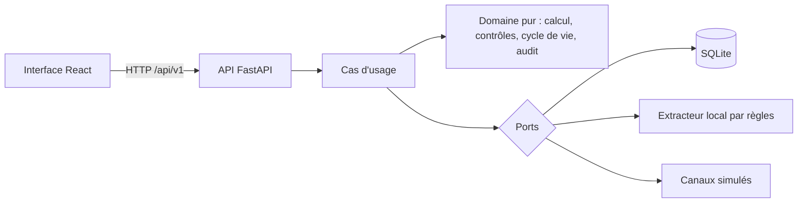

# Rapport : facturation assistée, de la pièce commerciale au règlement

> Statut : en vigueur · Mis à jour : 2026-11-26 · Responsables : Ange-Marie, Charbel ·
> Hackathon BWAI 2026, cas pratique 2

## 1. Besoin

Une PME béninoise reçoit ses commandes sous forme de devis, de bons de commande ou de messages
WhatsApp, puis ressaisit chaque facture à la main. Cette ressaisie coûte du temps et produit des
erreurs : client mal identifié, quantité ou prix mal recopiés, total faux, facture envoyée en double,
retard de paiement non relancé.

Le prototype transforme une pièce reçue en facture vérifiable : l'IA lit la pièce, un humain
confirme ce qui est incertain, un moteur déterministe calcule, un validateur valide et numérote,
puis la facture est émise, suivie et relancée jusqu'au règlement.

## 2. Parcours

| Étape | Qui | Ce que garantit le système |
| --- | --- | --- |
| Import (fichier ou message collé) | Opérateur | Extraction hors ligne ; chaque champ porte sa position dans la pièce et sa confiance |
| Revue | Opérateur | Seuls les champs incertains ou absents sont soumis ; une valeur absente n'est jamais inventée |
| Contrôles | Système | 10 codes d'anomalie (client ou article inconnu, doublon, prix inhabituel, total lu différent du total recalculé, quantité livrée différente, pièces contradictoires, champ obligatoire absent, confiance faible, gros montant) |
| Validation | Validateur | Bloquée tant qu'une anomalie bloquante reste ouverte ; l'auteur du brouillon ne peut pas valider ; numéro attribué sans trou |
| Émission | Opérateur | WhatsApp, SMS ou courriel (simulés), message exact conservé |
| Règlement | Opérateur | Montant plafonné au solde ; statut de paiement calculé |
| Correction | Validateur | Jamais de modification d'une facture validée : avoir, puis nouvelle facture |
| Recouvrement | Opérateur | Échéancier ; relance au ton adapté au retard (J-3, J+1, J+7) |
| Vérification | Client | QR code : la page publique confirme que la facture est authentique et inchangée |

Un assistant, Nera, répond aux questions (« pourquoi je ne peux pas valider ? », « explique ce
total », « quelles factures sont en retard ? ») à partir des données réelles et cite ses sources.

## 3. Architecture

- **Ports et adaptateurs** ([ADR 0001](../adr/0001-architecture-generale.md)) : le domaine
  n'importe aucune bibliothèque extérieure ; quatre règles de dépendance sont vérifiées à chaque
  intégration (import-linter).
- **Règles en configuration** : taxes, arrondis, ordre des remises, seuils, numérotation, canaux,
  relances, émetteur sont dans `config/*.yaml` ; leur empreinte SHA-256 est inscrite sur chaque
  facture validée.
- **Contrat d'API typé** : le schéma OpenAPI génère les types de l'interface ; l'intégration
  continue échoue si les deux divergent.
- **Installation** : `docker compose up --build`, interface sur le port 8080.
- **Ce qui est simulé** ([ADR 0005](../adr/0005-simulation-des-integrations.md)) : envois
  WhatsApp, SMS, courriel, relances et paiements mobile money, signalés comme tels à l'écran.
  L'extraction, le calcul, les contrôles, la numérotation et le journal sont réels.

## 4. Contrôles et sécurité

| Risque | Contrôle |
| --- | --- |
| Montant faux | Calcul en décimal exact par le moteur ; l'interface et l'IA ne calculent rien |
| Donnée inventée | Champ absent laissé vide ; validation bloquée tant qu'un champ obligatoire manque |
| Doublon (double clic, coupure) | Clé d'idempotence sur tout POST ; même clé, même réponse, aucun nouvel effet |
| Validations simultanées | Version de la facture (`If-Match`) ; la seconde reçoit 409 |
| Fraude interne | Rôles (opérateur, validateur, administrateur) ; séparation des tâches |
| Falsification a posteriori | Facture validée immuable ; journal d'audit chaîné par empreintes ; vérification publique par QR ([ADR 0006](../adr/0006-verification-publique.md)) |
| Accès | Jeton porteur, mots de passe hachés (scrypt), conteneur sans droits administrateur |

## 5. Protocole et résultats des tests

**Résultats métier** (exactitude des règles et des calculs), commande `make test` :

| Suite | Résultat |
| --- | --- |
| Backend : unitaires et intégration | 180 tests réussis, couverture 95,7 % |
| Frontend | 12 tests réussis |
| Analyse statique, types, règles de dépendance | Sans erreur (`make check`, intégration continue) |

Exemples de garanties couvertes par un test : TTC = HT + TVA sur des lignes aléatoires (tests de
propriétés) ; numérotation sans trou après un abandon ; relance envoyée une seule fois ; facture
modifiée directement en base détectée comme altérée ; reprise après redémarrage sans perte.

**Résultats IA** (extraction), mesurés séparément, détail dans la [fiche IA](../ia/fiche-ia.md) :

| Jeu | Rôle | Champs justes | Fausses certitudes au seuil 0,85 | Automatisé sans revue |
| --- | --- | --- | --- | --- |
| `mise-au-point` (10 pièces) | Réglage | 94,2 % (82/87) | 0 | 89,7 % |
| `controle` (6 pièces) | **Mesure de référence**, jamais vue avant l'évaluation | **94,3 % (66/70)** | **0** | 92,9 % |

## 6. Comparaison à la méthode de référence

Méthode de référence : la ressaisie manuelle de chaque champ de la pièce dans un tableur ou un
logiciel de facturation, calcul compris.

| Indicateur | Ressaisie manuelle | Prototype | Source |
| --- | --- | --- | --- |
| Champs à saisir par facture (jeu `controle`) | 70 sur 70 | 5 sur 70 à revoir (7,1 %) | Mesuré |
| Totaux faux détectés avant validation | Dépend de la relecture | 100 % des écarts du jeu (`AMOUNT_MISMATCH`) | Tests et scénarios |
| Factures en double | Possibles | Bloquées (`DUPLICATE_DOCUMENT`, idempotence) | Tests |
| Temps par facture | **[À COMPLÉTER]** : non mesuré | **[À COMPLÉTER]** : non mesuré | Protocole ci-dessous |

Le gain de temps n'a pas été chronométré pendant le hackathon : nous ne publions pas de chiffre
inventé. Protocole proposé : dix pièces réelles, traitées par trois personnes, une fois à la main
et une fois avec le prototype, en mesurant la durée et les erreurs de chaque facture.

## 7. Limites

- Pièces au format texte seulement ; les photos et PDF de bons de commande ne sont pas lus.
- L'extracteur par règles est fragile sur des formats très libres ; le modèle en ligne prévu en
  repli n'a pas été évalué faute de clé pendant le hackathon.
- Jeux d'évaluation petits (22 pièces) et écrits par l'équipe.
- Envois, relances et paiements simulés ; pas de conformité au système de facture normalisée
  béninois, à étudier avant tout usage réel.
- Jetons de session en mémoire ; base SQLite sur un seul poste.

## 8. Coûts estimatifs d'usage

| Poste | Estimation | Statut |
| --- | --- | --- |
| Extraction locale par règles | 0 FCFA par pièce, aucune donnée ne quitte le poste | Mesuré |
| Hébergement (une petite machine virtuelle) | **[À VÉRIFIER]** auprès d'un hébergeur | Hypothèse |
| Modèle en ligne optionnel | Appelé seulement pour les pièces incomplètes ; tarif **[À VÉRIFIER]** | Hypothèse |
| Envois WhatsApp, SMS | Tarifs des fournisseurs **[À VÉRIFIER]** | Hypothèse |

## 9. Étapes d'une expérimentation

1. Choisir deux PME volontaires et une centaine de pièces réelles anonymisées.
2. Mesurer la référence : temps et erreurs de la ressaisie manuelle, selon le protocole du § 6.
3. Mettre en service le prototype sur un poste, en parallèle de la méthode actuelle, pendant un
   mois.
4. Brancher un canal réel (WhatsApp Business) et un rappel de paiement mobile money.
5. Comparer temps, erreurs évitées et délai moyen d'encaissement ; décider de la suite.
